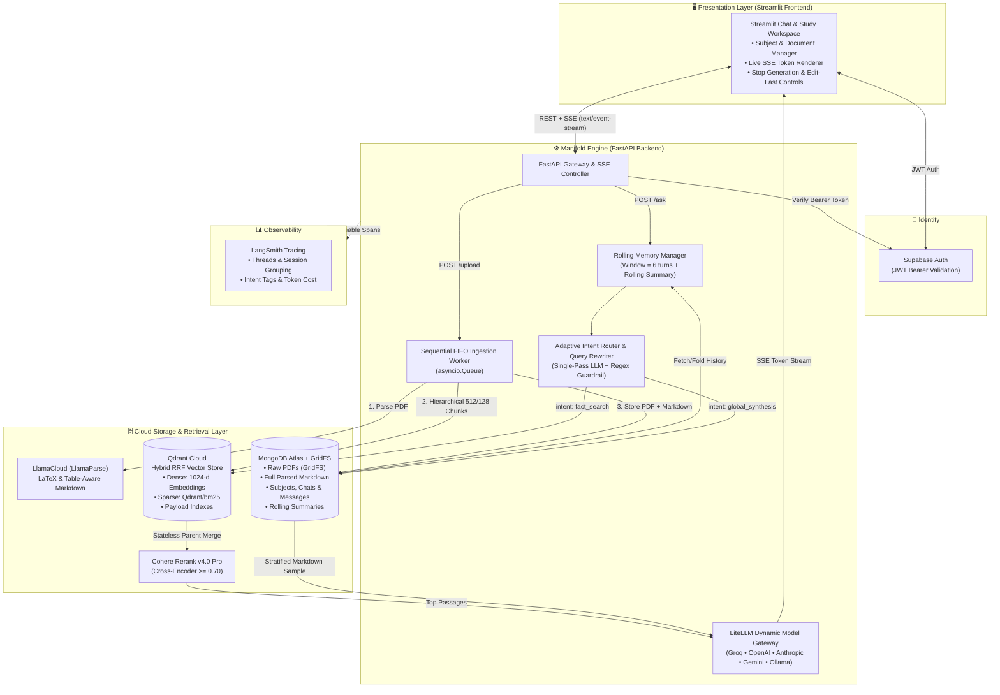
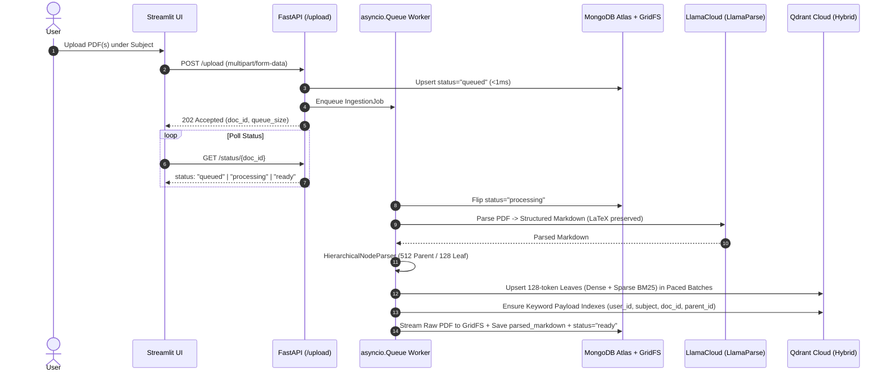
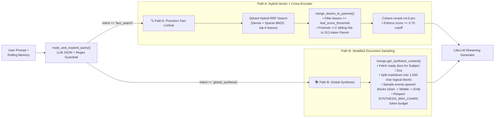
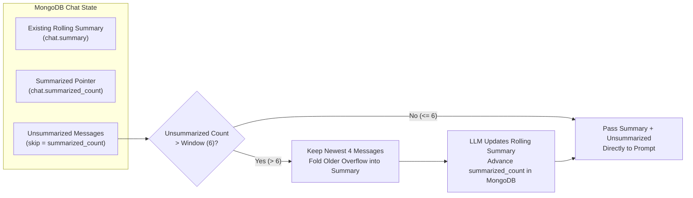

<div align="center">

# 🌌 Manifold

### Adaptive Hybrid-RAG & High-Dimensional Academic Synthesis Engine

[](https://www.python.org/)
[](https://fastapi.tiangolo.com/)
[](https://streamlit.io/)
[](https://qdrant.tech/)
[](https://www.mongodb.com/atlas)
[](https://docs.litellm.ai/)
[](https://smith.langchain.com/)
[](https://github.com/astral-sh/uv)

**Manifold** is a full-stack, cloud-native AI study and research platform that transforms dense academic PDFs (including LaTeX mathematics, tables, and code) into hierarchical parent-child vector spaces. Instead of forcing every user prompt through a brittle one-size-fits-all vector lookup, Manifold uses **Adaptive Intent Routing** to dynamically switch between **Hybrid Dense+Sparse Vector Search with Stateless Parent Promotion** and **Whole-Document Stratified Synthesis**.

</div>

---

## 📖 Table of Contents

1. [Why Manifold?](#-why-manifold)
2. [High-Level System Architecture](#-high-level-system-architecture)
3. [Core Pipelines & Flowcharts](#-core-pipelines--flowcharts)
   - [1. Sequential FIFO Ingestion Pipeline](#1-sequential-fifo-ingestion-pipeline)
   - [2. Adaptive Query Routing & Dual-Path Retrieval](#2-adaptive-query-routing--dual-path-retrieval)
   - [3. Rolling Window Memory Summarization](#3-rolling-window-memory-summarization)
   - [4. Interactive SSE Streaming, Stop & Edit-Last Controls](#4-interactive-sse-streaming-stop--edit-last-controls)
4. [Tech Stack](#-tech-stack)
5. [Repository Structure](#-repository-structure)
6. [Getting Started (Local & Cloud)](#-getting-started-local--cloud)
7. [Cloud Run Serverless Deployment](#-cloud-run-serverless-deployment)
8. [API Reference](#-api-reference)
9. [Observability & Evaluation](#-observability--evaluation)

---

## 🎯 Why Manifold?

Standard RAG pipelines break down in real university and research workflows for two fundamental reasons:

1. **Granularity vs. Context Trade-Off**: Small chunks (`128 tokens`) excel at high-precision vector similarity matching, but starve the LLM of surrounding context. Large chunks (`512+ tokens`) dilute the embedding vector.
   - **Manifold's Solution**: Indexes **128-token leaf chunks** using **Hybrid Search** (Dense `bge-large-en-v1.5` / Cohere + Sparse `BM25`) and uses **stateless parent promotion** to automatically merge matching sibling leaves back into their **512-token parent blocks** before passing them to the **Cohere `rerank-v4.0-pro` cross-encoder** (`>= 0.70` relevance cutoff).
2. **Pointwise Vector Search Fails on Global Meta-Queries**: When a student asks *"What is this unit about?"*, *"Summarize the entire lecture"*, or *"Generate 10 exam questions across this subject"*, semantic similarity against isolated chunks fails or gets dropped by strict reranker thresholds.
   - **Manifold's Solution**: A single-pass **Pre-Retrieval Intent Router** (reinforced by deterministic regex guardrails) classifies queries into `fact_search` or `global_synthesis`. Global synthesis queries bypass Qdrant entirely and execute **Stratified Markdown Sampling** across full parsed documents stored in MongoDB.

---

## 🏗️ High-Level System Architecture



---

## 🔄 Core Pipelines & Flowcharts

### 1. Sequential FIFO Ingestion Pipeline

Uploading multiple heavy academic PDFs simultaneously can exhaust container RAM or trigger external API rate limits (`429 Too Many Requests`). Manifold decouples file uploads from processing using an asynchronous **First-In, First-Out (`asyncio.Queue`) background worker** with rate-limit-aware batching.



---

### 2. Adaptive Query Routing & Dual-Path Retrieval

Every user question passes through a single-pass **Router & Query Expander** (`app/retrieval/expand.py`) that resolves conversational coreferences (*"it"*, *"that theorem"*) and classifies intent into one of two specialized retrieval paths:



---

### 3. Rolling Window Memory Summarization

To support arbitrarily long study sessions without blowing past LLM context windows or losing early context, Manifold implements a **Rolling Window Summarizer** (`app/generation/response.py`):



---

### 4. Interactive SSE Streaming, Stop & Edit-Last Controls

Manifold provides a responsive chat experience with real-time token streaming, mid-generation cancellation, and non-destructive prompt editing:

* **`POST /ask` (SSE Stream)**: Streams structured JSON events (`meta` $\rightarrow$ `token` $\rightarrow$ `done`) over `text/event-stream`.
* **`POST /chats/{chat_id}/stop` (Mid-Stream Cancellation)**: Sets an in-memory cancellation flag (`active_streams[chat_id] = True`) that immediately breaks the token generator loop, appends `*[Generation stopped by user]*`, and persists the partial response cleanly to MongoDB.
* **`POST /chats/{chat_id}/edit_last` (Prompt Rollback & Regeneration)**: Invokes `mongo.delete_last_interaction(chat_id)` to purge the most recent user message and its assistant reply (`created_at >= last_user_msg`), then immediately streams a fresh response for the edited prompt.

---

## 🛠️ Tech Stack

| Layer | Technology | Purpose |
| :--- | :--- | :--- |
| **Frontend UI** | Streamlit, Python | Multi-session chat workspace, subject/document manager, model selector, live SSE rendering |
| **Backend API** | FastAPI, Uvicorn, AsyncIO | REST endpoints, SSE streaming (`StreamingResponse`), sequential background ingestion queue |
| **Authentication** | Supabase Auth (`HTTPBearer`) | Email/Password signup, login, JWT refresh, and strict per-user multi-tenant isolation |
| **Document Parsing** | LlamaCloud (`LlamaParse`) | High-fidelity PDF-to-Markdown conversion preserving LaTeX formulas, tables, and code blocks |
| **Chunking** | LlamaIndex `HierarchicalNodeParser` | Dual-granularity splitting (`512`-token parents linked to `128`-token leaves) |
| **Vector Database** | Qdrant Cloud (`v1.19+`) | Native Hybrid Search (Dense embeddings + FastEmbed `Qdrant/bm25` sparse vectors) with keyword payload indexes |
| **Reranker** | Cohere `rerank-v4.0-pro` | Cross-encoder relevance scoring with a strict `0.70` hallucination guardrail |
| **Document & State DB** | MongoDB Atlas + GridFS | Stores raw PDFs (`GridFS`), full `parsed_markdown`, subjects, chat sessions, messages, and rolling summaries |
| **LLM Gateway** | LiteLLM | Dynamic 3-tier model discovery across Groq, OpenAI, Anthropic, Gemini, OpenRouter, Kimi, and Ollama |
| **Observability** | LangSmith (`@traceable`) | Full execution traces, multi-turn `session_id` thread grouping, intent tags, and token usage tracking |
| **Packaging & Infra** | `uv`, Docker Compose, Google Cloud Run | Reproducible lockfiles, multi-container orchestration, and serverless cloud deployment |

---

## 📂 Repository Structure

```text
manifold/
├── docker-compose.yml              # Full-stack orchestration (Frontend + API + Local DBs)
├── README.md                       # Project-wide architecture & documentation
│
├── app/                            # 🧠 Manifold FastAPI Backend
│   ├── Dockerfile                  # Production image with pre-baked FastEmbed ONNX models
│   ├── pyproject.toml              # Backend dependencies managed via uv
│   ├── main.py                     # FastAPI app, FIFO ingestion worker, SSE pipelines & routes
│   ├── account/
│   │   └── auth.py                 # Supabase client & JWT Bearer dependency (get_current_user)
│   ├── configs/
│   │   └── config.py               # Centralized Pydantic settings & RAG hyperparameters
│   ├── ingestion/
│   │   ├── parse.py                # LlamaCloud PDF-to-Markdown parser
│   │   ├── chunk.py                # 512/128 Hierarchical chunker & paced Qdrant indexer
│   │   ├── embed.py                # Embedding model factory (FastEmbed ONNX / Cohere)
│   │   ├── storage.py              # Qdrant Cloud hybrid client & keyword payload indexing
│   │   ├── mongo_store.py          # MongoDB Atlas + GridFS + Stratified Synthesis sampler
│   │   └── reset_store.py          # Cascading vector & document deletion utilities
│   ├── retrieval/
│   │   ├── expand.py               # Single-pass Adaptive Intent Router & Query Rewriter
│   │   ├── hybrid_search.py        # Qdrant RRF retriever & stateless leaf-to-parent merger
│   │   └── reranker.py             # Cohere v4.0 Pro cross-encoder with 0.70 cutoff
│   ├── generation/
│   │   ├── models.py               # 3-Tier dynamic LLM discovery & LiteLLM resolver
│   │   └── response.py             # Rolling memory summarizer & traced LiteLLM streaming
│   └── evaluation/                 # RAG evaluation scripts & test datasets
│
└── frontend/                       # 🖥️ Manifold Streamlit Frontend
    ├── Dockerfile                  # Containerized Streamlit service
    ├── pyproject.toml              # Frontend dependencies
    └── app.py                      # Streamlit UI, SSE client, session & document controls
```

---

## 🚀 Getting Started (Local & Cloud)

### Prerequisites
* **Docker & Docker Compose** (or Python `3.11+` and [`uv`](https://docs.astral.sh/uv/))
* API Keys for **Supabase**, **LlamaCloud**, **Cohere**, **LangSmith**, and at least one LLM provider (e.g., **Groq**, **OpenAI**, **Gemini**, or **Anthropic**).
* **MongoDB Atlas** URI and **Qdrant Cloud** URL + API Key (or local Docker containers).

### 1. Clone the Repository
```bash
git clone https://github.com/Mwaurajames/manifold.git
cd manifold
```

### 2. Configure Backend Environment (`./app/.env`)
Create `./app/.env` with your credentials:

```env
# --- MongoDB Atlas ---
MONGODB_USERNAME=your_atlas_username
MONGODB_PASSWORD=your_atlas_password
MONGODB_URI=mongodb+srv://<username>:<password>@cluster0.xxxxx.mongodb.net/?retryWrites=true&w=majority&appName=Cluster0
MONGO_DB_NAME=manifold

# --- Qdrant Cloud ---
QDRANT_URL=https://xxxxxxxx-xxxx-xxxx-xxxx-xxxxxxxxxxxx.us-central-1-0.gcp.cloud.qdrant.io:6333
QDRANT_API_KEY=your_qdrant_cloud_api_key
QDRANT_COLLECTION=university_nodes

# --- Supabase Authentication ---
SUPABASE_URL=https://your-project.supabase.co
SUPABASE_KEY=your_supabase_anon_key

# --- Ingestion, Reranking & Synthesis ---
LLAMA_CLOUD_API_KEY=llx-...
COHERE_API_KEY=...
SYNTHESIS_MAX_CHARS=10000

# --- LangSmith Observability ---
LANGCHAIN_TRACING_V2=true
LANGCHAIN_API_KEY=lsv2_...
LANGCHAIN_PROJECT=manifold

# --- LLM Providers (Add any combination; auto-discovered at runtime) ---
GROQ_API_KEY=gsk_...
# OPENAI_API_KEY=sk-...
# ANTHROPIC_API_KEY=sk-ant-...
# GEMINI_API_KEY=AIza...
```

### 3. Verify Cloud Database Connectivity
```bash
cd app
PYTHONPATH=. uv run python -c "
from ingestion.mongo_store import MongoStore
from ingestion.storage import Storage

mongo = MongoStore()
mongo.client.admin.command('ping')
print('✅ MongoDB Atlas Connected! DB:', mongo.db.name)

storage = Storage()
print('✅ Qdrant Cloud Connected! Collections:', storage.client.get_collections())
"
```

### 4. Run the Full Stack with Docker Compose
From the project root (`manifold/`):
```bash
docker compose up -d --build
```
* **Streamlit Frontend UI**: `http://localhost:8501` (or `http://<LAN_IP>:8501` on mobile hotspot)
* **FastAPI Backend & Swagger Docs**: `http://localhost:8000/docs`

---

## ☁️ Cloud Run Serverless Deployment

Manifold is architected for zero-maintenance serverless deployment on **Google Cloud Run** paired with **MongoDB Atlas** and **Qdrant Cloud**:

1. **Pre-Baked ONNX Embeddings**: `./app/Dockerfile` pre-caches `BAAI/bge-large-en-v1.5` and `Qdrant/bm25` into `/srv/app/models` during image build so serverless cold starts boot in seconds without downloading from Hugging Face.
2. **Deploy Backend (`manifold-api`)**:
   ```bash
   gcloud run deploy manifold-api \
     --source ./app \
     --region us-central1 \
     --allow-unauthenticated \
     --port 8000 \
     --cpu 2 \
     --memory 2Gi \
     --min-instances 0 \
     --max-instances 1 \
     --timeout 600 \
     --env-vars-file ./app/env.yaml
   ```
3. **Deploy Frontend (`manifold-frontend`)**:
   ```bash
   gcloud run deploy manifold-frontend \
     --source ./frontend \
     --region us-central1 \
     --allow-unauthenticated \
     --port 8501 \
     --cpu 1 \
     --memory 1Gi \
     --min-instances 0 \
     --max-instances 2 \
     --session-affinity \
     --set-env-vars="API_URL=https://manifold-api-xxxxxxxxxx-uc.a.run.app,DB_PATH=/tmp/app.db"
   ```

---

## 📡 API Reference

| Category | Method | Endpoint | Description |
| :--- | :--- | :--- | :--- |
| **Auth** | `POST` | `/auth/signup` | Register a new user via Supabase Auth |
| **Auth** | `POST` | `/auth/login` | Authenticate user and return JWT `access_token` & `refresh_token` |
| **Auth** | `POST` | `/auth/refresh` | Refresh an expired Supabase session |
| **Auth** | `GET` | `/auth/me` | Verify Bearer JWT and return active `user_id` |
| **Models** | `GET` | `/models` | Dynamically discover all LLMs with configured API keys |
| **Subjects** | `POST` | `/subjects` | Create or ensure a study subject namespace |
| **Subjects** | `GET` | `/subjects` | List all subjects belonging to the authenticated user |
| **Subjects** | `DELETE` | `/subjects/{subject}` | Cascading delete across Qdrant vectors, GridFS PDFs, docs & chats |
| **Documents** | `POST` | `/upload` | Enqueue one or more PDFs into the sequential FIFO ingestion worker |
| **Documents** | `GET` | `/status/{doc_id}` | Poll ingestion status (`queued` $\rightarrow$ `processing` $\rightarrow$ `ready` / `failed`) |
| **Documents** | `GET` | `/documents` | List uploaded documents (optionally filtered by `subject`) |
| **Documents** | `DELETE` | `/documents/{doc_id}` | Remove a single document from Qdrant, MongoDB, and GridFS |
| **Chat & RAG** | `POST` | `/chats` | Initialize a new study chat session |
| **Chat & RAG** | `GET` | `/chats` | List user chat sessions ordered by most recent activity |
| **Chat & RAG** | `GET` | `/chats/{chat_id}/messages` | Fetch chronological message history for a session |
| **Chat & RAG** | `POST` | `/ask` | Run the Adaptive RAG pipeline (streams SSE `meta`, `token`, `done`) |
| **Chat & RAG** | `POST` | `/documents/{doc_id}/ask` | Scope `/ask` strictly to a single document |
| **Chat & RAG** | `POST` | `/chats/{chat_id}/stop` | Abort an active SSE generation stream mid-response |
| **Chat & RAG** | `POST` | `/chats/{chat_id}/edit_last` | Roll back the last user/assistant turn and stream an edited prompt |
| **Chat & RAG** | `DELETE` | `/chats/{chat_id}` | Delete a chat session and all associated messages |

---

## 📊 Observability & Evaluation

Manifold integrates deeply with **LangSmith**:
* **Root Run Formatting**: Streaming SSE generators are automatically reduced via `_reduce_sse_stream_for_langsmith` so every conversation renders as clean User/Assistant chat bubbles in the LangSmith UI.
* **Multi-Turn Thread Grouping**: Every trace attaches `session_id: chat_id`, `user_id`, `subject`, and `model` metadata, grouping multi-turn study sessions automatically under the **LangSmith Threads** tab.
* **Routing Visibility**: Each `retrieval_pipeline` trace records `query_intent` (`fact_search` vs. `global_synthesis`) and `expanded_query` tags for instant debugging of retrieval routing decisions.

---

<div align="center">
  <sub>Built with precision for high-dimensional academic retrieval and synthesis.</sub>
</div>