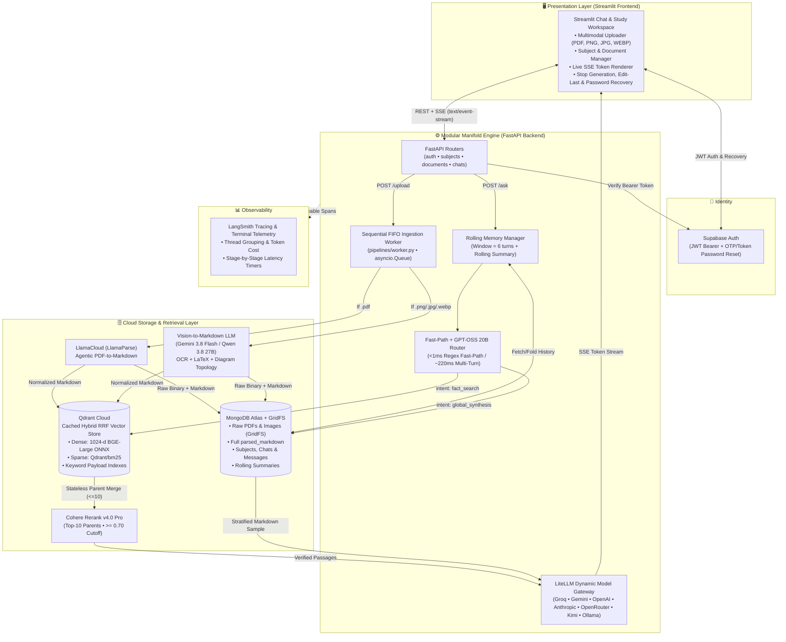
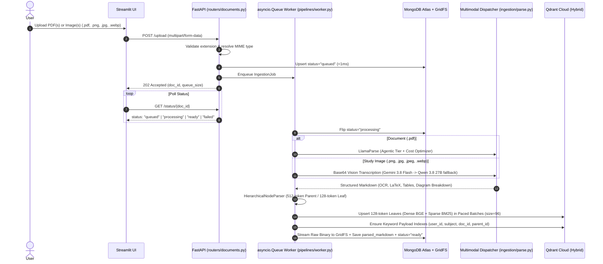
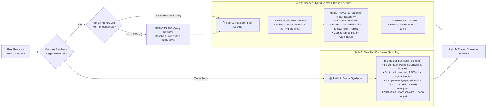
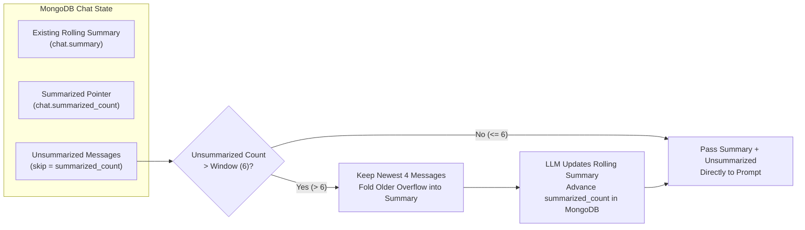

<div align="center">

# 🌌 Manifold

### Adaptive Multimodal Hybrid-RAG & High-Dimensional Academic Synthesis Engine

[](https://www.python.org/)
[](https://fastapi.tiangolo.com/)
[](https://streamlit.io/)
[](https://qdrant.tech/)
[](https://www.mongodb.com/atlas)
[](https://docs.litellm.ai/)
[](https://smith.langchain.com/)
[](https://github.com/astral-sh/uv)

**Manifold** is a full-stack, cloud-native AI study and research platform that transforms dense academic PDFs and study images (handwritten notes, lecture slides, circuit schematics, and diagrams) into hierarchical parent-child vector spaces. Instead of forcing every user prompt through a brittle one-size-fits-all vector lookup, Manifold uses **Zero-Latency Fast-Path & Adaptive Intent Routing** to dynamically switch between **Hybrid Dense+Sparse Vector Search with Stateless Parent Promotion** and **Whole-Document Stratified Synthesis**.

</div>

---

## 📖 Table of Contents

1. [Why Manifold?](#-why-manifold)
2. [High-Level System Architecture](#-high-level-system-architecture)
3. [Core Pipelines & Flowcharts](#-core-pipelines--flowcharts)
   - [1. Multimodal Sequential FIFO Ingestion Pipeline](#1-multimodal-sequential-fifo-ingestion-pipeline)
   - [2. Low-Latency Adaptive Query Routing & Dual-Path Retrieval](#2-low-latency-adaptive-query-routing--dual-path-retrieval)
   - [3. Rolling Window Memory Summarization](#3-rolling-window-memory-summarization)
   - [4. Interactive SSE Streaming, Stop, Edit-Last & Password Recovery](#4-interactive-sse-streaming-stop-edit-last--password-recovery)
4. [Supported LLM & Multimodal Vision Catalog](#-supported-llm--multimodal-vision-catalog)
5. [Tech Stack](#-tech-stack)
6. [Modular Repository Structure](#-modular-repository-structure)
7. [Getting Started (Local & Cloud)](#-getting-started-local--cloud)
8. [Cloud Run Serverless Deployment](#-cloud-run-serverless-deployment)
9. [API Reference](#-api-reference)
10. [Observability & Terminal Telemetry](#-observability--terminal-telemetry)

---

## 🎯 Why Manifold?

Standard RAG pipelines break down in real university and research workflows for three fundamental reasons:

1. **Multimodal Study Materials (PDFs + Diagrams/Handwritten Notes)**: Students study from both 50-page lecture PDFs and snapshots of whiteboards, circuit schematics, and textbook charts.
   - **Manifold's Solution**: Implements **Vision-to-Markdown Normalization** (`app/ingestion/parse.py`). Documents route to **LlamaParse (`agentic` tier)**, while images (`.png`, `.jpg`, `.jpeg`, `.webp`) route to vision-capable LLMs (**Gemini 3.8 Flash** and **Groq Qwen 3.8 27B Vision** with automatic fallback) that extract verbatim OCR, inline/block LaTeX (`$...$` and `$$...$$`), Markdown tables for charts, and topological breakdowns of diagrams so downstream vector and synthesis pipelines work uniformly.
2. **Granularity vs. Context Trade-Off**: Small chunks (`128 tokens`) excel at high-precision vector similarity matching, but starve the LLM of surrounding context. Large chunks (`512+ tokens`) dilute the embedding vector.
   - **Manifold's Solution**: Pre-warms and indexes **128-token leaf chunks** using **Hybrid Search** (Dense `BAAI/bge-large-en-v1.5` / Cohere + Sparse `Qdrant/bm25`) and uses **stateless parent promotion** to automatically merge matching sibling leaves back into their **512-token parent blocks** (capped at top 10 candidates) before passing them to the **Cohere `rerank-v4.0-pro` cross-encoder** (`>= 0.70` relevance cutoff).
3. **Pointwise Vector Search Fails on Global Meta-Queries & Adds Router Latency**: When a student asks *"What is this unit about?"*, *"Summarize the entire lecture"*, or *"Generate 10 exam questions"*, semantic similarity against isolated chunks fails. Conversely, calling a heavy LLM router on every single turn adds seconds of latency.
   - **Manifold's Solution**: A **3-Tier Pre-Retrieval Router** (`app/retrieval/expand.py`) resolves explicit synthesis queries and self-contained Turn-1 factual queries in **<1ms via deterministic regex fast-paths**, and only invokes ultra-fast **`groq/openai/gpt-oss-20b` (~1,000 tok/s)** when multi-turn pronoun/coreference expansion is required. Global synthesis queries bypass Qdrant and execute **Stratified Markdown Sampling** across full parsed documents stored in MongoDB Atlas.

---

## 🏗️ High-Level System Architecture



---

## 🔄 Core Pipelines & Flowcharts

### 1. Multimodal Sequential FIFO Ingestion Pipeline

Uploading multiple heavy academic PDFs or high-resolution study images simultaneously can exhaust container RAM or trigger external API rate limits (`429 Too Many Requests`). Manifold decouples uploads from processing using an asynchronous **First-In, First-Out (`asyncio.Queue`) background worker** (`app/pipelines/worker.py`).



---

### 2. Low-Latency Adaptive Query Routing & Dual-Path Retrieval

Every user question passes through `route_and_expand_query()` (`app/retrieval/expand.py`), which eliminates unnecessary LLM calls on Turn-1 or self-contained queries and uses **`groq/openai/gpt-oss-20b`** (~1,000 tok/s) when conversational coreference expansion is needed:



---

### 3. Rolling Window Memory Summarization

To support arbitrarily long study sessions without blowing past LLM context windows or losing early context, Manifold implements a **Rolling Window Summarizer** (`app/generation/response.py`):



---

### 4. Interactive SSE Streaming, Stop, Edit-Last & Password Recovery

* **`POST /ask` (SSE Stream)**: Streams structured JSON events (`meta` $\rightarrow$ `token` $\rightarrow$ `done`) over `text/event-stream` while skipping redundant MongoDB session creation calls on existing chats.
* **`POST /chats/{chat_id}/stop` (Mid-Stream Cancellation)**: Sets an in-memory cancellation flag (`active_streams[chat_id] = True`) that immediately breaks the token generator loop, appends `*[Generation stopped by user]*`, and persists the partial response cleanly to MongoDB.
* **`POST /chats/{chat_id}/edit_last` (Prompt Rollback & Regeneration)**: Invokes `mongo.delete_last_interaction(chat_id)` to purge the most recent user message and its assistant reply (`created_at >= last_user_msg`), then immediately streams a fresh response for the edited prompt.
* **Supabase Password Recovery (`/auth/forgot-password`, `/auth/reset-password`, `/auth/update-password`)**: Supports both 6-digit email recovery OTPs and redirect URL token bridges (`#access_token=...&type=recovery` $\rightarrow$ `?access_token=...` in Streamlit) without requiring custom SMTP infrastructure.

---

## 🤖 Supported LLM & Multimodal Vision Catalog

Manifold dynamically exposes models via `GET /models` (`app/generation/models.py`) based on which provider API keys are configured in `./app/.env`:

| Provider (`ENV_KEY`) | Model ID | Speed / Context | Role in Manifold |
| :--- | :--- | :--- | :--- |
| **Groq** (`GROQ_API_KEY`) | `groq/openai/gpt-oss-120b` | ~500 tok/s • 131K | Default Flagship Open-Weight Reasoning |
| **Groq** (`GROQ_API_KEY`) | `groq/openai/gpt-oss-20b` | ~1,000 tok/s • 131K | Ultra-Fast Chat & Multi-Turn Query Rewriter |
| **Groq** (`GROQ_API_KEY`) | `groq/qwen/qwen3.8-27b` | ~450 tok/s • 131K | Multimodal Vision Transcription & Reasoning |
| **Groq** (`GROQ_API_KEY`) | `groq/meta-models/muse-spark-open` | ~350 tok/s • 131K | 816B MoE (42B active) Deep Reasoning |
| **Groq** (`GROQ_API_KEY`) | `groq/minimaxai/minimax-m2.7` | ~260 tok/s • 196K | Extended 196K Context Enterprise Model |
| **Groq** (`GROQ_API_KEY`) | `groq/llama-3.3-70b-versatile` | ~280 tok/s • 131K | Dense Enterprise Generalist |
| **Groq** (`GROQ_API_KEY`) | `groq/openai/gpt-oss-safeguard-20b` | Ultra-Fast • 131K | Safety-Filtered Reasoning & Moderation |
| **Google Gemini** (`GEMINI_API_KEY`) | `gemini/gemini-3.8-flash` | High-Speed Multimodal | Primary Vision-to-Markdown Transcriber & Chat |
| **Google Gemini** (`GEMINI_API_KEY`) | `gemini/gemini-2.5-pro` | Deep Reasoning | Complex STEM Derivations & Multimodal Fallback |
| **OpenAI** (`OPENAI_API_KEY`) | `openai/gpt-4.1` / `gpt-4.1-mini` / `gpt-4o-mini` | Standard / Fast | General Chat & Vision Fallback |
| **Anthropic** (`ANTHROPIC_API_KEY`) | `anthropic/claude-sonnet-4-6` / `claude-haiku-4-5` | High Precision | Academic Writing, Proofs & Vision Fallback |
| **OpenRouter** (`OPENROUTER_API_KEY`) | `openrouter/nvidia/nemotron-3-ultra-550b-a55b:free` | MoE Reasoning | Free-Tier High-Capacity Reasoning |
| **Moonshot AI** (`KIMI_API_KEY`) | `openai/moonshot-v1-8k` | 8K Context | Custom OpenAI-Compatible Endpoint |
| **Local Ollama** (`OLLAMA_MODELS`) | `ollama/<model_name>` | Local Hardware | Offline / Local Inference |

---

## 🛠️ Tech Stack

| Layer | Technology | Purpose |
| :--- | :--- | :--- |
| **Frontend UI** | Streamlit, Python | Multi-session chat workspace, multimodal file uploader, subject/document manager, model selector, live SSE rendering |
| **Backend API** | FastAPI (`APIRouter`), Uvicorn, AsyncIO | Modular REST endpoints, SSE streaming (`StreamingResponse`), sequential background ingestion queue |
| **Authentication** | Supabase Auth (`HTTPBearer`) | Email/Password signup, login, JWT refresh, OTP/link password reset, and per-user multi-tenant isolation |
| **Multimodal Parsing** | LlamaCloud (`LlamaParse`) + LiteLLM Vision | High-fidelity PDF-to-Markdown (`LlamaParse`) and Image-to-Markdown (`Gemini 3.8 Flash` / `Qwen 3.8 27B`) |
| **Chunking** | LlamaIndex `HierarchicalNodeParser` | Dual-granularity splitting (`512`-token parents linked to `128`-token leaves) |
| **Embeddings** | FastEmbed ONNX (`BAAI/bge-large-en-v1.5`) / Cohere | Pre-warmed 1024-d dense embeddings + `Qdrant/bm25` sparse lexical representations |
| **Vector Database** | Qdrant Cloud (`v1.19+`) | Native Hybrid Search (Dense + Sparse RRF) with cached `VectorStoreIndex` and keyword payload indexes |
| **Reranker** | Cohere `rerank-v4.0-pro` | Cross-encoder relevance scoring over top-10 merged parent blocks with a strict `0.70` cutoff |
| **Document & State DB** | MongoDB Atlas + GridFS | Stores raw PDFs/images (`GridFS`), full `parsed_markdown`, subjects, chat sessions, messages, and rolling summaries |
| **LLM Gateway** | LiteLLM | Dynamic 3-tier model discovery across 7+ providers with automatic vision fallback |
| **Observability** | LangSmith (`@traceable`) + Python `logging` | Full LLM/chain spans, multi-turn `session_id` thread grouping, and stage-by-stage terminal latency logs |

---

## 📂 Modular Repository Structure

```text
Study_Assistant/
├── docker-compose.yml              # Full-stack orchestration (Frontend + API)
├── README.md                       # Project-wide architecture & documentation
│
├── app/                            # 🧠 Modular Manifold FastAPI Backend
│   ├── Dockerfile                  # Production image with pre-baked FastEmbed ONNX models
│   ├── pyproject.toml              # Backend dependencies managed via uv
│   ├── main.py                     # Clean ~60-line entrypoint: Lifespan worker, CORS & router registration
│   ├── schemas.py                  # All Pydantic request/response models & IngestionJob dataclass
│   ├── dependencies.py             # Shared singletons (Qdrant, Mongo, pre-warmed Embed, queues, logger)
│   │
│   ├── pipelines/                  # Core orchestration & background workers
│   │   ├── __init__.py
│   │   ├── worker.py               # Sequential FIFO ingestion_worker() & ingest_pipeline()
│   │   └── rag.py                  # retrieval_pipeline(), response_pipeline(), stream_response_pipeline()
│   │
│   ├── routers/                    # Domain-grouped FastAPI APIRouter modules
│   │   ├── __init__.py
│   │   ├── auth.py                 # /auth/signup, /login, /refresh, /me, /forgot-password, /reset-password
│   │   ├── subjects.py             # /subjects (POST, GET, cascading DELETE)
│   │   ├── documents.py            # /upload (PDF + Images), /status/{doc_id}, /documents
│   │   └── chats.py                # /models, /ask, /chats, /chats/{chat_id}/stop, /edit_last
│   │
│   ├── account/
│   │   └── auth.py                 # Supabase client & JWT Bearer dependency (get_current_user)
│   ├── configs/
│   │   └── config.py               # Centralized Pydantic settings & RAG hyperparameters
│   ├── ingestion/
│   │   ├── parse.py                # Multimodal dispatcher: LlamaParse (Docs) + Vision LLM (Images)
│   │   ├── chunk.py                # 512/128 Hierarchical chunker & paced Qdrant batch indexer
│   │   ├── embed.py                # Embedding model factory (FastEmbed ONNX / Cohere)
│   │   ├── qdrant_store.py         # Qdrant Cloud hybrid client & keyword payload indexing
│   │   ├── mongo_store.py          # MongoDB Atlas + GridFS + Stratified Synthesis sampler
│   │   └── reset_store.py          # Cascading vector & document deletion utilities
│   ├── retrieval/
│   │   ├── expand.py               # <1ms Fast-Path Regex + GPT-OSS 20B Intent Router & Query Rewriter
│   │   ├── hybrid_search.py        # Cached Qdrant RRF retriever & top-10 leaf-to-parent merger
│   │   └── reranker.py             # Cohere v4.0 Pro cross-encoder with 0.70 cutoff
│   ├── generation/
│   │   ├── models.py               # 3-Tier dynamic LLM discovery, vision fallback & LangSmith wrappers
│   │   ├── prompts.py              # Academic system prompts & query expansion templates
│   │   └── response.py             # Rolling memory summarizer & traced LiteLLM streaming
│   └── evaluation/                 # RAG evaluation scripts & test datasets
│
└── frontend/                       # 🖥️ Manifold Streamlit Frontend
    ├── Dockerfile                  # Containerized Streamlit service
    ├── pyproject.toml              # Frontend dependencies
    └── app.py                      # Streamlit UI, multimodal uploader, SSE client & auth recovery bridge
```

---

## 🚀 Getting Started (Local & Cloud)

### Prerequisites
* **Docker & Docker Compose** (or Python `3.11+` and [`uv`](https://docs.astral.sh/uv/))
* API Keys for **Supabase**, **LlamaCloud**, **Cohere**, **LangSmith**, and at least one LLM/Vision provider (**Groq**, **Gemini**, **OpenAI**, or **Anthropic**).
* **MongoDB Atlas** URI and **Qdrant Cloud** URL + API Key.

### 1. Clone the Repository
```bash
git clone https://github.com/Mwaurajames/manifold.git
cd manifold
```

### 2. Configure Backend Environment (`./app/.env`)
Create `./app/.env` with your credentials:

```env
# --- MongoDB Atlas ---
MONGODB_USERNAME=your_atlas_username
MONGODB_PASSWORD=your_atlas_password
MONGODB_URI=mongodb+srv://<username>:<password>@cluster0.xxxxx.mongodb.net/?retryWrites=true&w=majority&appName=Cluster0
MONGO_DB_NAME=manifold

# --- Qdrant Cloud ---
QDRANT_URL=https://xxxxxxxx-xxxx-xxxx-xxxx-xxxxxxxxxxxx.us-central-1-0.gcp.cloud.qdrant.io:6333
QDRANT_API_KEY=your_qdrant_cloud_api_key
QDRANT_COLLECTION=university_nodes

# --- Supabase Authentication ---
SUPABASE_URL=https://your-project.supabase.co
SUPABASE_KEY=your_supabase_anon_key

# --- Ingestion, Reranking & Synthesis ---
LLAMA_CLOUD_API_KEY=llx-...
COHERE_API_KEY=...
SYNTHESIS_MAX_CHARS=10000
EXPAND_MODEL=groq/openai/gpt-oss-20b
# VISION_MODEL=gemini/gemini-3.8-flash

# --- LangSmith Observability ---
LANGCHAIN_TRACING_V2=true
LANGCHAIN_API_KEY=lsv2_...
LANGCHAIN_PROJECT=manifold

# --- LLM & Vision Providers (Auto-discovered at runtime) ---
GROQ_API_KEY=gsk_...
GEMINI_API_KEY=AIza...
# OPENAI_API_KEY=sk-...
# ANTHROPIC_API_KEY=sk-ant-...
```

### 3. Run Locally with `uv`
```bash
# Terminal 1: Start the FastAPI Backend
cd app
uv run uvicorn main:app --host 0.0.0.0 --port 8000

# Terminal 2: Start the Streamlit Frontend
cd frontend
uv run streamlit run app.py --server.port 8501
```
* **Streamlit Frontend UI**: `http://localhost:8501`
* **FastAPI Interactive Swagger Docs**: `http://localhost:8000/docs`

---

## ☁️ Cloud Run Serverless Deployment

Manifold is architected for cost-controlled serverless deployment on **Google Cloud Run** (staying within the `$0.00` Always Free Tier via request-based CPU allocation and pre-baked models):

1. **Pre-Baked ONNX Embeddings**: `./app/Dockerfile` pre-caches `BAAI/bge-large-en-v1.5` and `Qdrant/bm25` into `/srv/app/models` at build time, and `dependencies.py` warms up both dense and sparse encoders at boot so cold starts and first queries execute without Hugging Face download lag.
2. **Deploy Backend (`manifold-api`)**:
   ```bash
   gcloud run deploy manifold-api \
     --source ./app \
     --region us-central1 \
     --allow-unauthenticated \
     --port 8000 \
     --cpu 2 \
     --memory 2Gi \
     --min-instances 0 \
     --max-instances 1 \
     --timeout 600 \
     --env-vars-file ./app/env.yaml
   ```
3. **Deploy Frontend (`manifold-frontend`)**:
   ```bash
   gcloud run deploy manifold-frontend \
     --source ./frontend \
     --region us-central1 \
     --allow-unauthenticated \
     --port 8501 \
     --cpu 1 \
     --memory 1Gi \
     --min-instances 0 \
     --max-instances 2 \
     --session-affinity \
     --set-env-vars="API_URL=https://manifold-api-xxxxxxxxxx-uc.a.run.app,DB_PATH=/tmp/app.db"
   ```

---

## 📡 API Reference

| Router Module | Method | Endpoint | Description |
| :--- | :--- | :--- | :--- |
| **`routers/auth.py`** | `POST` | `/auth/signup` | Register a new user via Supabase Auth |
| **`routers/auth.py`** | `POST` | `/auth/login` | Authenticate user and return JWT `access_token` & `refresh_token` |
| **`routers/auth.py`** | `POST` | `/auth/refresh` | Refresh an expired Supabase session |
| **`routers/auth.py`** | `GET` | `/auth/me` | Verify Bearer JWT and return active `user_id` |
| **`routers/auth.py`** | `POST` | `/auth/forgot-password` | Trigger a Supabase password recovery email |
| **`routers/auth.py`** | `POST` | `/auth/reset-password` | Verify 6-digit recovery OTP and set new password |
| **`routers/auth.py`** | `POST` | `/auth/update-password` | Update password using recovery redirect session tokens |
| **`routers/subjects.py`** | `POST` | `/subjects` | Create or ensure a study subject namespace |
| **`routers/subjects.py`** | `GET` | `/subjects` | List all subjects belonging to the authenticated user |
| **`routers/subjects.py`** | `DELETE` | `/subjects/{subject}` | Cascading delete across Qdrant vectors, GridFS binaries, docs & chats |
| **`routers/documents.py`** | `POST` | `/upload` | Enqueue PDFs or images (`.pdf`, `.png`, `.jpg`, `.jpeg`, `.webp`) into FIFO worker |
| **`routers/documents.py`** | `GET` | `/status/{doc_id}` | Poll ingestion status (`queued` $\rightarrow$ `processing` $\rightarrow$ `ready` / `failed`) |
| **`routers/documents.py`** | `GET` | `/documents` | List uploaded documents (optionally filtered by `subject`) |
| **`routers/documents.py`** | `DELETE` | `/documents/{doc_id}` | Remove a single document from Qdrant, MongoDB, and GridFS |
| **`routers/chats.py`** | `GET` | `/models` | Dynamically discover all LLMs with configured API keys |
| **`routers/chats.py`** | `POST` | `/chats` | Initialize a new study chat session |
| **`routers/chats.py`** | `GET` | `/chats` | List user chat sessions ordered by most recent activity |
| **`routers/chats.py`** | `GET` | `/chats/{chat_id}/messages` | Fetch chronological message history for a session |
| **`routers/chats.py`** | `POST` | `/ask` | Run the Adaptive RAG pipeline (streams SSE `meta`, `token`, `done`) |
| **`routers/chats.py`** | `POST` | `/documents/{doc_id}/ask` | Scope `/ask` strictly to a single document |
| **`routers/chats.py`** | `POST` | `/chats/{chat_id}/stop` | Abort an active SSE generation stream mid-response |
| **`routers/chats.py`** | `POST` | `/chats/{chat_id}/edit_last` | Roll back the last user/assistant turn and stream an edited prompt |
| **`routers/chats.py`** | `DELETE` | `/chats/{chat_id}` | Delete a chat session and all associated messages |

---

## 📊 Observability & Terminal Telemetry

Manifold provides dual-layer observability across **LangSmith** and **structured terminal logs**:
* **Stage-by-Stage Terminal Telemetry**: Every ingestion and retrieval step logs execution durations (`ms`/`s`), leaf/parent counts, reranker scores, and single-line truncated text previews (`[Ingest:Step 1/4]`, `[Retrieval:Router]`, `[Retrieval:HybridSearch]`, `[Retrieval:Rerank Done]`, `[Ask:Stream]`).
* **LangSmith Root Run Formatting**: Streaming SSE generators are reduced via `_reduce_sse_stream_for_langsmith` so every conversation renders as clean User/Assistant chat bubbles in LangSmith.
* **Multi-Turn Thread Grouping**: Every trace attaches `session_id: chat_id`, `user_id`, `subject`, and `model` metadata, grouping multi-turn study sessions under the **LangSmith Threads** tab alongside `intent:fact_search` and `intent:global_synthesis` routing tags.

---

<div align="center">
  <sub>Built with precision for high-dimensional multimodal academic retrieval and synthesis.</sub>
</div>